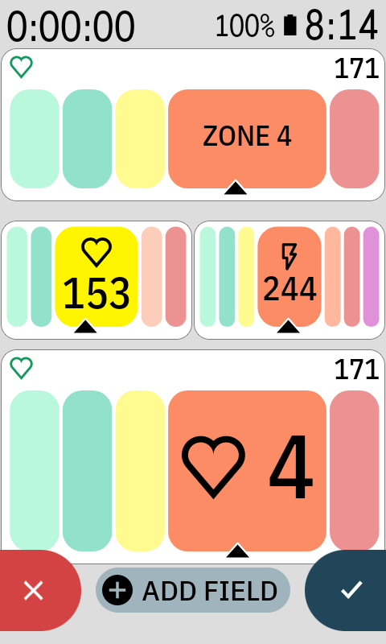

# Zone Bars for Karoo

Karoo 3 data fields that show your current zone, styled after the Apple Watch workout view. HR fields use heart rate and power fields use 3-second average power, each with the zones from your Karoo rider profile.

Each comes in three styles:

- **Zone Bar** (HR Zone Bar, Power Zone Bar): the value in the header and the current zone labelled "ZONE n".
- **Zone Bar Big**: the value in the header and a large zone number in the current zone.
- **Zone Bar Full**: no header; the bars use the full height and the value sits inside the current zone.

A marker under the current zone shows how far through it you are.

<p align="center">
  
  
</p>

## Install

Download the APK from the [latest release](https://github.com/dmccullum/karoo-zone-bars/releases/latest), then sideload it onto your Karoo 3. You need `adb` from the [Android platform-tools](https://developer.android.com/tools/releases/platform-tools).

1. On the Karoo: Settings → About → tap the build number 7 times, then enable USB debugging in Developer options.
2. Connect it over USB and accept the debugging prompt on the Karoo.
3. Run `adb install -r <file>.apk` with the file name you downloaded.
4. Edit a ride profile page, tap a field, and pick one of the fields under **Zone Bars**.

Upgrading from 1.0: release 1.1 is signed with a new key, so Android won't install it over 1.0. Run `adb uninstall com.danielmccullum.hrzones` first, then install 1.1 and add the field to your pages again. Later updates install over 1.1 with `adb install -r`.

## Build from source

Requires JDK 17 and the Android SDK (platform 35). Android Studio is the easiest way to get both.

1. Create a GitHub token with `read:packages` scope. karoo-ext is published on GitHub Packages, which requires a token even for public packages.
2. Add to `~/.gradle/gradle.properties`:
   ```
   gpr.user=<your GitHub username>
   gpr.key=<token>
   ```
3. Run `./gradlew assembleDebug`. The APK is written to `app/build/outputs/apk/debug/app-debug.apk`; install it as above.

`./gradlew assembleRelease` signs with your own keystore if you set `hrzones.storeFile`, `hrzones.storePassword`, `hrzones.keyAlias` and `hrzones.keyPassword` in `~/.gradle/gradle.properties`; otherwise it falls back to the debug key. An app signed with a different key has to be uninstalled before it can be replaced.

## Files

- `HrZonesExtension.kt`: registers the HR and power fields in each style
- `ZoneBarDataType.kt`: streams the source value (heart rate or 3-second average power) and renders the field, including the editor preview sweep
- `ZoneBarRenderer.kt`: draws the header, zone segments, pill, value and pointer for each style; the HR and power zone colors are set here
- `KarooLayout.kt`: Karoo's own header text and icon sizes for each field size
- `ZonePosition.kt`: maps a value to a zone index and position within that zone

## License

Copyright (C) 2026 Daniel McCullum. Released under the [GNU General Public License v3.0](LICENSE).
